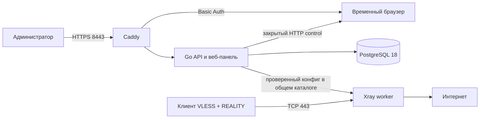

# Архитектура

На одном VPS Docker Compose запускает пять сервисов. Caddy отдаёт панель по HTTPS на 8443, Xray принимает VLESS + REALITY на 443. PostgreSQL, API и browser worker не имеют опубликованных host-портов. Порт 80 нужен Caddy для автоматического TLS-сертификата.

Go API использует pgx/v5, запросы sqlc и миграции golang-migrate. Устройства имеют отдельные UUID доступа, хранимые в базе в шифротексте AES-GCM. Мастер-ключ, локальный CLI-токен, хеш пароля администратора, TOTP-секрет и закрытый REALITY-ключ находятся в защищённом файле окружения вне Git. После настройки учётной записи публичный вход администратора требует логин, пароль и TOTP; панель получает временный сеанс. Экспорт VLESS URI и конфигураций клиентов выполняется только после авторизации; каждый формат содержит секрет устройства.

Создание или отзыв устройства меняет желаемую ревизию. «Применить конфигурацию» создаёт конфиг Xray, проверяет его настоящим Xray, атомарно заменяет файл и ждёт подтверждения, что отдельный Xray-контейнер запустил именно эту версию файла. При неудаче API восстанавливает предыдущий конфиг. Xray читает файл и обслуживает уже действующие подключения без обращения к БД; отказ PostgreSQL блокирует управление, но не обязан останавливать VPN-трафик.

Browser worker не имеет Docker socket или host mounts и не получает шлюзовые ключи. Доступ к noVNC идёт через Caddy, браузерный профиль находится в tmpfs. Docker Engine на VPS работает с системными правами; доступ к его socket равен административному доступу и разрешён только оператору сервера.

Пока поддерживается один сервер, один Xray-узел, одна учётная запись администратора и один браузерный сеанс. Для внутренних команд API-контейнера сохранён отдельный долгоживущий токен. QR-код профиля и автоматический Docker rollout уже реализованы. Роли пользователей, несколько узлов и дополнительные сквозные проверки перечислены в [roadmap](roadmap.md).
