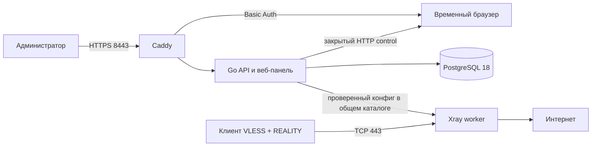

# Архитектура

На одном VPS Docker Compose запускает пять сервисов. Caddy отдаёт панель по HTTPS на 8443, Xray принимает VLESS + REALITY на 443. PostgreSQL, API и browser worker не имеют опубликованных host-портов. Порт 80 нужен Caddy для автоматического TLS-сертификата.

## Языки и стек по частям программы

| Часть | Язык и стек | За что отвечает |
| --- | --- | --- |
| Панель управления | TypeScript, React, TanStack Query, Vite, CSS | Экраны входа, устройств, конфигурации и браузера. Исходники — [web/src](../web/src/App.tsx); готовые файлы отдаёт Go API через Caddy. |
| API и командная утилита | Go, `chi`, Cobra | Авторизация администратора, устройства, профили клиентов, применение конфигурации Xray и управление браузером. Код — [internal](../internal/httpapi/server.go) и [gatewayctl](../cmd/gatewayctl/main.go). |
| База данных | PostgreSQL 18, SQL, `pgx/v5`, `sqlc`, `golang-migrate` | Хранит состояние шлюза, устройства и журнал действий. Запросы — [queries.sql](../internal/storage/queries.sql), миграции — [internal/storage/migrations](../internal/storage/migrations/000001_initial.up.sql). |
| VPN-трафик | Xray, VLESS + REALITY | Принимает подключения совместимых клиентов на TCP 443 и передаёт трафик. Go API создаёт конфигурацию, а [Xray worker](../deploy/docker/xray-worker.py) запускает её в отдельном контейнере. |
| Удалённый браузер | Chromium, Python, noVNC, VNC | Chromium открывает сайты на VPS, noVNC показывает его экран в панели, а [Python worker](../deploy/docker/browser-worker.py) запускает и останавливает временный сеанс. |
| HTTPS и контейнеры | Caddy, Docker Compose | Caddy обслуживает панель и noVNC по HTTPS на 8443; [Compose](../deploy/docker/compose.yml) запускает пять сервисов и их внутренние сети. |
| Установка, обновление и проверки | Bash, Python, GitHub Actions YAML | [Скрипты установки](../deploy/docker/install.sh) собирают и обновляют стек; [CI/CD](../.github/workflows/ci.yml) проверяет код и доставляет успешный релиз на VPS. |

На iPhone, Android и ПК используются сторонние VLESS + REALITY клиенты: проект выдаёт им URI, QR-код или конфигурационный файл, но не содержит собственного мобильного приложения. Node.js нужен для сборки панели, на VPS он не запускается.

Go API использует pgx/v5, запросы sqlc и миграции golang-migrate. Устройства имеют отдельные UUID доступа, хранимые в базе в шифротексте AES-GCM. Логин и хеш пароля администратора хранятся в PostgreSQL; после подтверждения кода в браузере там же сохраняется зашифрованный TOTP-секрет и шаг последнего использованного кода. Мастер-ключ, локальный CLI-токен и закрытый REALITY-ключ находятся в защищённом файле окружения вне Git. Публичный вход администратора проходит в два этапа: логин и пароль, затем настройка или проверка TOTP; панель получает временный сеанс. Экспорт VLESS URI и конфигураций клиентов выполняется только после авторизации; каждый формат содержит секрет устройства.

Создание или отзыв устройства меняет желаемую ревизию. «Применить конфигурацию» создаёт конфиг Xray, проверяет его настоящим Xray, атомарно заменяет файл и ждёт подтверждения, что отдельный Xray-контейнер запустил именно эту версию файла. При неудаче API восстанавливает предыдущий конфиг. Xray читает файл и обслуживает уже действующие подключения без обращения к БД; отказ PostgreSQL блокирует управление, но не обязан останавливать VPN-трафик.

Browser worker не имеет Docker socket или host mounts и не получает шлюзовые ключи. Доступ к noVNC идёт через Caddy, браузерный профиль находится в tmpfs. Docker Engine на VPS работает с системными правами; доступ к его socket равен административному доступу и разрешён только оператору сервера.

Пока поддерживается один сервер, один Xray-узел, одна учётная запись администратора и один браузерный сеанс. Для внутренних команд API-контейнера сохранён отдельный долгоживущий токен. QR-код профиля и автоматический Docker rollout уже реализованы. Роли пользователей, несколько узлов и дополнительные сквозные проверки перечислены в [roadmap](roadmap.md).
