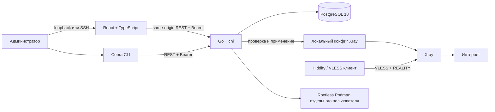

# Архитектура первой версии

Это односерверный шлюз с отдельными каналами управления и трафика. API и веб-интерфейс предназначены для администратора. Профиль VLESS + REALITY можно импортировать в Hiddify или другой совместимый клиент. Подключение браузера на сервере — отдельная опция, описанная в [browser.md](browser.md).

Go-сервис использует pgx/v5, sqlc и golang-migrate; контракт API описан в OpenAPI 3.1. Веб-интерфейс использует Vite и TanStack Query. CLI обращается к тем же REST-методам, что и веб-интерфейс.

## Устройства и применение

Для устройства выдаётся отдельный UUID клиента. База хранит его шифротекст AES-GCM; мастер-ключ поступает из `GATEWAY_MASTER_KEY` и хранится отдельно от базы и Git. URI подключения содержит действующий UUID и потому является секретом. Имена устройств, даты и события аудита не содержат UUID клиента.

Добавление и отзыв устройства изменяют желаемую конфигурацию и её ревизию. Эти операции остаются в состоянии `pending`, пока администратор не применит конфигурацию. Применение генерирует конфиг Xray из актуальных устройств, проверяет его через установленный Xray и выполняет заданную команду перезапуска. После успешного завершения фиксируется применённая ревизия. Состояние API позволяет отличить сохранение в базе от применения в процессе Xray. Отзыв в базе сам по себе ещё не отключает соединение.

События управления записываются в добавляемый журнал аудита. Прикладной API не предоставляет редактирование или удаление этих событий. Это не защита от администратора базы, способного менять схему и данные напрямую.

Xray читает локальный конфиг и не запрашивает PostgreSQL для каждого соединения. Отказ базы мешает новым операциям управления, но текущий процесс Xray может продолжать работу с уже применённым конфигом.

## Границы реализации

Первая версия поддерживает один узел, список устройств, выдачу профиля, отзыв, аудит и явное применение конфигурации. Масштабирование на несколько узлов, очередь задач, пул worker-процессов, кеш и автоматическое восстановление конфигурации требуют отдельной реализации. Авторизация API использует один административный Bearer-токен; полноценного управления пользователями и ролями пока нет.

API по умолчанию слушает `127.0.0.1:8080`. Веб-интерфейс получает данные с того же origin; токен нужно вводить в интерфейсе, а не встраивать в сборку. Мастер-ключ, закрытый REALITY-ключ, токен API и профили нельзя включать в репозиторий, журналы или публичные артефакты. Этот шлюз не обещает анонимность и не устраняет утечки на устройстве клиента; проверки описаны в [privacy-checks.md](privacy-checks.md).
