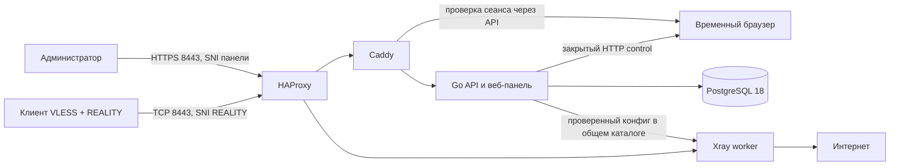

# Архитектура

На одном VPS Docker Compose запускает шесть сервисов. HAProxy принимает основной TCP 8443 и совместимый TCP 443 и по SNI направляет запросы к домену панели в Caddy, а VLESS + REALITY — в Xray. Caddy использует порт 80 для HTTP-01 и перенаправляет HTTP на HTTPS с 8443; TLS-ALPN challenge отключён, так что сертификат не зависит от внешнего 443; оба опубликованных TLS-порта направлены на один внутренний вход HAProxy. PostgreSQL, API, Xray StatsService и browser worker не имеют опубликованных host-портов.

## Языки и стек по частям программы

| Часть | Язык и стек | За что отвечает |
| --- | --- | --- |
| Панель управления | TypeScript, React, TanStack Query, Vite, CSS | Экраны входа, устройств, конфигурации, браузера, инструкций и проверки подключения. Исходники — [web/src](../web/src/App.tsx); готовые файлы отдаёт Go API через Caddy. |
| API и командная утилита | Go, `chi`, Cobra | Авторизация администратора, устройства, профили клиентов, применение конфигурации Xray и управление браузером. Код — [internal](../internal/httpapi/server.go) и [gatewayctl](../cmd/gatewayctl/main.go). |
| База данных | PostgreSQL 18, SQL, `pgx/v5`, `sqlc`, `golang-migrate` | Хранит состояние шлюза, устройства и журнал действий. Запросы — [queries.sql](../internal/storage/queries.sql), миграции — [internal/storage/migrations](../internal/storage/migrations/000001_initial.up.sql). |
| VPN-трафик и счётчики | Xray, VLESS + REALITY, StatsService | Принимает подключения совместимых клиентов через основной TCP 8443 (443 сохранён для совместимости), передаёт трафик и предоставляет только внутреннему API байты по профилю с последнего запуска Xray. Внешний порт `GATEWAY_PORT=8443` независим от внутреннего `GATEWAY_XRAY_PORT=443`. Go API создаёт конфигурацию, а [Xray worker](../deploy/docker/xray-worker.py) запускает её в отдельном контейнере. |
| Удалённый браузер | Chromium, Python, noVNC, VNC | Chromium открывает сайты на VPS, noVNC показывает его экран в панели, а [Python worker](../deploy/docker/browser-worker.py) запускает и останавливает временный сеанс. |
| HTTPS и контейнеры | HAProxy, Caddy, Docker Compose | [HAProxy](../deploy/docker/haproxy.cfg.template) разделяет HTTPS панели и VPN-трафик на TCP 443 и 8443 по SNI. Caddy обслуживает панель и noVNC; [Compose](../deploy/docker/compose.yml) запускает шесть сервисов и их внутренние сети. |
| Установка, обновление и проверки | Bash, Python, GitHub Actions YAML | [Скрипты установки](../deploy/docker/install.sh) собирают и обновляют стек; [CI/CD](../.github/workflows/ci.yml) проверяет код теми же проверками в Docker, что и [`scripts/dev.sh test`](../scripts/dev.sh), и доставляет успешный релиз на все серверы из [`deploy/servers`](../deploy/servers). |

На iPhone, Android и ПК используются сторонние VLESS + REALITY клиенты: проект выдаёт им URI, QR-код или конфигурационный файл, но не содержит собственного мобильного приложения. Node.js нужен для сборки панели, на VPS он не запускается.

Go API использует pgx/v5, запросы sqlc и миграции golang-migrate. Устройства имеют отдельные UUID доступа, хранимые в базе в шифротексте AES-GCM. Логин и хеш пароля администратора хранятся в PostgreSQL; после подтверждения кода в браузере там же сохраняется зашифрованный TOTP-секрет и шаг последнего использованного кода. Мастер-ключ, локальный CLI-токен и закрытый REALITY-ключ находятся в защищённом файле окружения вне Git. Публичный вход администратора проходит в два этапа: логин и пароль, затем настройка или проверка TOTP; панель получает временный сеанс. Экспорт VLESS URI и конфигураций клиентов выполняется только после авторизации; каждый формат содержит секрет устройства.

Создание или отзыв устройства меняет желаемую ревизию. «Применить конфигурацию» создаёт конфиг Xray, проверяет его настоящим Xray, атомарно заменяет файл и ждёт подтверждения, что отдельный Xray-контейнер запустил именно эту версию файла. При неудаче API восстанавливает предыдущий конфиг. Xray читает файл и обслуживает уже действующие подключения без обращения к БД; отказ PostgreSQL блокирует управление, но не обязан останавливать VPN-трафик.

Проверка сервера в панели (`GET /api/v1/checks`) идёт из API-контейнера по внутренним сетям Docker: TLS к Caddy (`caddy:443`) для сертификата панели и настоящее VLESS-подключение к Xray (`xray:443`) временным клиентом Xray с профилем одного устройства — так же, как подключается приложение; через него API открывает сайт, который сообщает видимый IP. Сайт маскировки REALITY API проверяет напрямую.

Browser worker не имеет Docker socket или host mounts и не получает шлюзовые ключи. Caddy проверяет доступ к noVNC у API: после полной проверки логина, пароля и TOTP панель получает отдельный cookie для маршрута `/browser`, привязанный к сеансу администратора. Cookie не передаётся в browser worker, а выход и смена пароля отменяют новые подключения. Уже установленный WebSocket действует до закрытия соединения или остановки браузера. Браузерный профиль находится в tmpfs. Docker Engine на VPS работает с системными правами; доступ к его socket равен административному доступу и разрешён только оператору сервера.

Пока поддерживается один управляемый сервер, один Xray-узел, одна учётная запись администратора и один браузерный сеанс. Для внутренних команд API-контейнера сохранён отдельный долгоживущий токен. QR-код профиля и автоматический Docker rollout уже реализованы. Нагрузка каждого профиля отображается как переданные байты с последнего запуска Xray; число подключений и CPU по человеку пока не подсчитываются. Несколько управляемых узлов перечислены в [roadmap](roadmap.md).

Все прежние TCP-форматы выдачи используют текущий внешний порт узла: VLESS URI/QR,
base64-подписка, sing-box, Mihomo и ссылки импорта приложений. Переключателя входа
нет. Совместимые старые параметры `port=primary` и `port=8443` не меняют этот порт.
Смена публичного порта узла проходит через обычную желаемую/применённую ревизию,
сохраняя существующие устройства и ключи. Дополнительный опубликованный 443
обслуживает старые профили в доступных сетях, но не организует failover приложения.

## Дополнительный транспорт XHTTP

[XHTTP + REALITY](xhttp.md) включается отдельно в том же процессе Xray: порт,
ключи REALITY и путь независимы от TCP + Vision, UUID и счётчик устройства общие.
Новый TCP-порт публикует только подключаемый при включении `compose.xhttp.yml`;
выключенная функция не резервирует порт. Старые входы HAProxy остаются прежними.
Параметры нового входа учитываются в хеше желаемой конфигурации; публичная подписка
предлагает XHTTP только после применения ревизии. Авторизованный экспорт допускает
подготовку профиля до применения. Отзыв и применение исключают UUID из обоих входов.
Применение конфигурации может прервать текущие соединения общего процесса.
