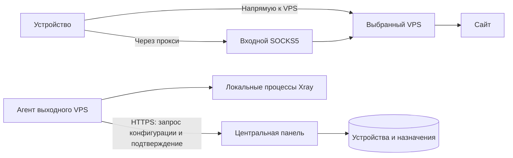

# Управление VPS и входными прокси

Панель хранит VPN-серверы и отдельно входные SOCKS5-прокси. В карточке VPS
выбирается один способ входа для новых профилей всех его устройств; на устройстве
затем выбирается профиль этого VPS. В обоих режимах сайты видят выходной IP VPS:



Прежний режим «IP прокси», в котором Xray выходил в интернет через SOCKS
**после VPS**, больше не выдаётся.
Его старые подписки не должны превращаться в прямые профили. Сам аккаунт
провайдера прокси не удаляется: его реквизиты владелец вводит как входной прокси.

## Действия в панели

1. Для режима **Через прокси** откройте **Серверы → Входные прокси → Добавить прокси**.
   Введите адрес, порт и при необходимости логин и пароль SOCKS5. Для обычного
   TCP-прокси оставьте поддержку UDP выключенной.
2. В карточке VPS в поле **Способ подключения** выберите **Напрямую к VPS** либо
   **Через прокси**, для второго варианта выберите созданный SOCKS5 и отдельно
   нажмите **Сохранить способ подключения**. Этот выбор меняет клиентский путь
   для всех устройств VPS и не требует применения Xray.
3. В **Устройствах** создайте устройство для нужного VPS. Примените конфигурацию
   этого сервера и дождитесь подтверждённой применённой версии.
4. Откройте **Профиль**. Для прямого входа выдаются обычный VLESS-профиль и
   подписка; для входа через прокси скачайте JSON-профиль цепочки и импортируйте
   его в совместимую версию Private Gateway Client.

Пароль не возвращается в список прокси. При редактировании адреса сохранённые
логин и пароль остаются; для их изменения включите **Заменить логин и пароль**.
Удаление назначенного прокси запрещено. Выключенный прокси сохраняет назначение:
прямое подключение автоматически не включается.

### Смена способа входа

Смена режима в карточке VPS не меняет уже импортированные профили и открытые
соединения: они сохраняют прежний маршрут. Обновление прежней подписки также
не переводит прямой VLESS-импорт в цепочку или цепочку на прямой вход: это разные
форматы и токены. Чтобы не получить дубликаты и не восстановить старую карточку
автоматическим обновлением стандартной подписки:

1. После сохранения режима откройте **Устройства → Профиль** и заранее скачайте
   новый файл либо ссылку через сеть, в которой панель доступна.
2. Отключите VPN в приложении. В разделе **Подписки** удалите прежнюю группу
   этого VPS целиком. Если профиль был добавлен без подписки, удалите только
   прежний локальный профиль этого VPS.
3. Импортируйте новый файл либо ссылку, выберите новый сервер в приложении и
   подключитесь. Повторите для других устройств этого VPS, где нужен новый путь.

Удаляется только старый импорт **в приложении**: устройство на сайте и входной
прокси в панели не удаляйте. При выборе **Напрямую к VPS** сохранённые реквизиты
SOCKS5 остаются в панели для будущего использования. При отказе назначенного
SOCKS5 клиент не переходит на прямое соединение сам.

### Замена прокси

Добавьте новый прокси либо измените реквизиты существующего и назначьте его VPS.
Нажмите **Обновить** у подписки в клиенте и переподключитесь. Подписка
загружается через сохранённый входной SOCKS5, в том числе при выключенном VPN.
Профили VPS, реквизиты SOCKS и адрес подписки сохраняются атомарно. Открытые
соединения до переподключения используют прежние настройки. Если старый прокси уже недоступен и панель напрямую закрыта,
получите новый файл через доступное соединение и импортируйте его вручную.
Ссылка подписки сама по себе не создаёт канал связи с недоступной панелью.

Отдельная кнопка **Новая подписка цепочки** отзывает прежний токен. После этой
операции импортируйте новый файл: получить новый секрет по отозванному URL нельзя.
Для обычной смены прокси менять токен подписки не требуется.

## Форматы профиля

Обычный `vless://` содержит один VPN endpoint и не передаёт цепочку SOCKS → VLESS.
В режиме **Напрямую к VPS** выдаются стандартный `vless://` и обычная подписка.
В режиме **Через прокси** панель выдаёт JSON `ChainBundle` версии 1:
адрес входного SOCKS5, его реквизиты, профили выбранного VPS и отдельную подписку
цепочки. В списке подключений клиента появляются варианты VPS.

Файл и подписка содержат секреты. Они выдаются отдельным авторизованным действием;
сами данные профиля не хранятся в кеше запросов панели или localStorage.
У цепочки отдельный токен: старый владелец прямой подписки не получает пароль
SOCKS автоматически. Отзыв устройства закрывает его подписки; VPN-доступ
прекращается после применения отзыва на VPS.

Один общий SOCKS-аккаунт может быть импортирован на несколько устройств. Отзыв
VLESS-устройства не меняет пароль у провайдера SOCKS; для отзыва доступа к самому
прокси нужны отдельные аккаунты либо ротация общих реквизитов.

## Несколько VPS

Центральная панель хранит устройства каждого узла отдельно. Локальный VPS
применяет конфигурацию через свой менеджер Xray. Удалённый VPS использует агент,
который сам устанавливает HTTPS-соединение с панелью; общий административный
токен панели и пароль SSH ему не передаются.

При добавлении удалённого VPS панель выдаёт одноразовый код регистрации.
После регистрации агент получает индивидуальный секрет. Закрытые ключи REALITY
хранятся на VPS. Агент получает список разрешённых UUID, проверяет конфигурацию
настоящим Xray, применяет её с откатом при ошибке и подтверждает конкретную
ревизию. Отправка команды и регистрация агента ещё не означают, что VPN работает.

Удалить VPS можно после отзыва, применения отзыва и удаления его устройств.
Новый сервер не добавляется автоматически в список полной CI-выкладки
`deploy/servers`: это отдельная роль удалённого VPN-узла.

### Установка удалённого VPS

Нужен Linux VPS с Docker Engine и Compose v2. Скачайте на него один проверенный
CI-артефакт и распакуйте: рядом должны лежать `release.tar.gz`,
`release.tar.gz.sha256`, `install/install-node.sh` и
`install/verify-release.py`. В каталоге с этими файлами на VPS проверьте релиз
и создайте ключи REALITY:

```bash
sha256sum --check release.tar.gz.sha256
python3 install/verify-release.py --tar release.tar.gz
install -d -m 0700 "$HOME/.private-gateway-keygen"
tar -xOf release.tar.gz bin/xray > "$HOME/.private-gateway-keygen/xray"
chmod 0700 "$HOME/.private-gateway-keygen/xray"
"$HOME/.private-gateway-keygen/xray" x25519
```

Открытый ключ укажите в панели, закрытый оставьте только на VPS. Для
XHTTP/REALITY выполните последнюю команду ещё раз и используйте **вторую**
пару; короткие ID и случайные пути для двух входов тоже должны различаться.

1. В панели добавьте VPS с его публичным адресом и портом TCP 8443, открытым
   ключом REALITY, SNI и short ID. При включении XHTTP укажите отдельный
   публичный ключ, путь и порт TCP 8444. Сохраните ID узла и одноразовый код
   регистрации. Входной SOCKS назначается отдельно в панели и на VPS не
   устанавливается.
2. На VPS создайте закрытый файл `root:root 0600`, например
   `sudo install -m 0600 /dev/null /root/private-gateway-node.env` и
   `sudoedit /root/private-gateway-node.env`. Для TCP и XHTTP его содержимое:

   ```dotenv
   GATEWAY_CONTROL_URL=https://panel.example.com:8443
   GATEWAY_NODE_ID=<ID из панели>
   GATEWAY_HOST=<публичный адрес этого VPS>
   GATEWAY_PORT=8443
   GATEWAY_REALITY_PRIVATE_KEY=<закрытый ключ TCP, созданный на VPS>
   GATEWAY_SERVER_NAME=www.cloudflare.com
   GATEWAY_SHORT_ID=<короткий ID TCP из панели>
   GATEWAY_REALITY_TARGET=www.cloudflare.com:443
   GATEWAY_XHTTP_ENABLED=1
   GATEWAY_XHTTP_PORT=8444
   GATEWAY_XHTTP_PRIVATE_KEY=<второй закрытый ключ>
   GATEWAY_XHTTP_SHORT_ID=<короткий ID XHTTP из панели>
   GATEWAY_XHTTP_PATH=<случайный путь XHTTP из панели>
   GATEWAY_XHTTP_H3_ENABLED=0
   ```

   `GATEWAY_CONTROL_URL` — точный HTTPS origin панели, обычно с портом 8443,
   без `/` на конце. Адрес, публичные порты, SNI, short ID и пути в файле
   должны совпадать с карточкой VPS. Для только TCP задайте
   `GATEWAY_XHTTP_ENABLED=0` и уберите поля XHTTP-ключа. Установщик сам
   добавит тег релиза и пути локального состояния; токен агента в env-файл не
   помещается.
3. Запустите на VPS:

   ```bash
   sudo bash install/install-node.sh --archive release.tar.gz --env-file /root/private-gateway-node.env
   ```

   Введите одноразовый код в
   скрытый запрос терминала. Агент сохранит индивидуальный токен в
   `/var/lib/private-gateway-node/agent.token` с правами `0600` и запустится.
4. В панели нажмите **Применить** для этого VPS. Это требуется и для пустого
   нового узла: до команды агент не получает конфигурацию Xray. Затем
   выполните на VPS:

   ```bash
   sudo bash install/install-node.sh --resume --archive release.tar.gz
   ```

   Повторная команда использует сохранённый токен и проверяет
   здоровье настроенных процессов, не регистрируя узел заново. Если первая
   регистрация оборвалась до сохранения токена, `--resume` запросит новый
   одноразовый код скрытым вводом; существующий токен она не заменяет.
5. В панели убедитесь, что применённая ревизия совпадает с желаемой,
   `agent_error` пуст, и проверьте настоящий HTTPS через выданный профиль.
   Здоровый контейнер сам по себе не подтверждает доступность из вашей сети.

Для H3 на VPS потребуются домен, указывающий на этот VPS, TCP 80 для выпуска
сертификата и выбранный UDP-порт (обычно 8444). В карточке и закрытом env
задайте одинаковые `GATEWAY_XHTTP_H3_DOMAIN`, `GATEWAY_XHTTP_H3_PORT`,
`GATEWAY_XHTTP_H3_PATH`, `GATEWAY_XHTTP_H3_INTERNAL_PORT=8081` и
`GATEWAY_XHTTP_H3_ENABLED=1`. TCP 8444 прежнего XHTTP и UDP 8444 H3 могут
сосуществовать. Входящий H3 нужно отдельно проверить по UDP до выдачи его
клиенту; текущая цепочка приложения H3 пока не предлагает.

## TCP и XHTTP

| Вариант | Внешнее соединение | Что требуется от входного SOCKS |
| --- | --- | --- |
| VLESS TCP + REALITY + Vision | TCP | SOCKS5 CONNECT |
| VLESS XHTTP + REALITY | HTTP/2 поверх TCP | SOCKS5 CONNECT |
| VLESS XHTTP + TLS, HTTP/3 | QUIC поверх UDP | UDP ASSOCIATE и доступный UDP relay |

TCP/Vision и XHTTP обслуживают отдельные процессы и файлы конфигурации.
Ошибка XHTTP не должна останавливать рабочий TCP/Vision. Общий IP VPS, назначенный
входной прокси и интернет устройства остаются общими зависимостями.
Применённая ревизия пока общая: новая цепочка выдаётся после успешного применения
всех включённых транспортов. Ошибка одного входа задержит выдачу новой цепочки,
хотя второй процесс продолжит работу.

XHTTP не означает обязательный UDP: прежний REALITY-вариант использует TCP.
HTTP/3 выдаётся отдельно при настройке TLS-входа. Отметка о поддержке UDP у
SOCKS отражает заданную возможность; она не заменяет сетевую проверку.
В текущий профиль входной цепочки H3 не включается: сквозная передача UDP
через SOCKS в Private Gateway Client ещё не подтверждена. TCP/Vision и
XHTTP/REALITY используют проверяемый механизм SOCKS5 CONNECT.
Переключение вариантов выполняет клиент, наличие нескольких профилей само по
себе не включает автоматическое переключение.

## Что проверять после установки

- Удалённый агент получает только свой узел; устаревшее подтверждение не отмечает
  новую ревизию применённой.
- Создание и отзыв устройства доходят до нужного VPS; второй VPS не меняется.
- При недоступности входного SOCKS нет прямого соединения устройства с VPS.
- Настоящий HTTPS через цепочку показывает выходной IP выбранного VPS.
- После смены SOCKS импорт/обновление и переподключение используют новые данные.
- Ошибка XHTTP не останавливает уже работающее TCP/Vision-подключение.
- H3 проверяется отдельно с UDP, с конкретным прокси и клиентом.

Серверные и автоматические проверки не подтверждают доступность цепочки из
мобильной или домашней сети владельца. Подтверждённая ранее разовая Windows-проба
SOCKS → TCP/Vision относится к старому диагностическому скрипту; постоянное
подключение обновлённого приложения требует отдельной проверки.
