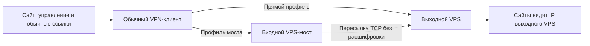

# Управление выходными VPS и входными мостами

Панель управляет выходными VPN-серверами. Для каждого VPS выбирается один
способ подключения для новых и обновляемых профилей его устройств:

- **Напрямую к VPS**: устройство соединяется с выходным сервером.
- **Через VPS-мост**: устройство соединяется с доступным входным VPS,
  который пересылает зашифрованное TCP-соединение на выходной сервер.



В обоих режимах выдаются стандартные VLESS URI/QR и обычная подписка.
Клиенту требуется поддержка выбранного транспорта и REALITY. Поддержка
TCP/Vision и XHTTP проверяется отдельно; совместимость со всеми клиентами
не обещается. Специальный формат Private Gateway Client не используется.

## Настройка в панели

1. Откройте **Серверы** и карточку нужного **выходного** VPS.
2. В поле **Способ подключения** выберите **Напрямую к VPS** или
   **Через VPS-мост**. Для моста укажите его публичный IP/домен и разные порты
   **TCP/Vision на мосту** и **XHTTP на мосту**, если у выхода включён XHTTP.
   Адрес и порты самого выходного VPS при этом не меняйте.
3. Нажмите **Сохранить способ подключения**. Это сохраняет маршрут выдаваемых
   профилей, но ещё не устанавливает мост и не подтверждает его доступность.
4. Для моста нажмите **Скачать настройку моста**. Файл содержит маршруты всех
   выходных VPS, назначенных этому же адресу моста. Установите файл на входном
   VPS по [пошаговой инструкции](bridge.md), затем проверьте настоящий VPN-трафик.
   Смена адреса или порта выхода требует заново сохранить маршрут и применить
   файл на мосту. Один порт моста нельзя назначить нескольким выходам.
5. Откройте **Устройства → Профиль**, выберите TCP/Vision либо XHTTP и импортируйте
   ссылку/QR или обычную подписку в ваш VPN-клиент. Сайты должны видеть IP выхода.

Для переключения маршрута обновите обычную подписку в клиенте и переподключитесь.
Вручную добавленную URI замените новой. До обновления уже импортированные
профили сохраняют старый адрес. Если мост недоступен, обычный профиль моста
не переключается напрямую сам; автоматический выбор других профилей зависит
от настроек конкретного клиента.

Панель и URL подписки по умолчанию остаются на домене центрального сайта.
Сам мост VPN не делает этот домен доступным из любой сети. Для первоначального
получения профиля и обновлений нужен доступ к панели; ограничения входа
панели через мост описаны отдельно в [инструкции](bridge.md).

## Переход с отменённой SOCKS5-цепочки

По решению владельца от 2026-11-17 поддержка покупных входных SOCKS5 и
собственного JSON ChainBundle удалена. Входные прокси не назначаются,
их зашифрованные реквизиты очищаются миграцией. Старые цепочки и их подписки
возвращают `410 Gone`; токен цепочки не становится обычной VPN-подпиской.
Прежний режим выхода в интернет через покупной прокси также не возвращён.

У VPS с прежним назначением SOCKS5 маршрут становится **не выбран**. Выдача
профилей остановлена, пока владелец явно не выберет прямой вход или мост.
Остальные VPS, устройства, UUID и обычные подписки сохраняются.
После обновления приложения удалённые профили старой цепочки нужно заменить
обычной ссылкой из панели. Аккаунт у поставщика прокси и ранее созданные
резервные копии панели этим обновлением не удаляются.

## Несколько VPS

Центральная панель хранит устройства каждого узла отдельно. Локальный VPS
применяет конфигурацию через свой менеджер Xray. Удалённый VPS использует агент,
который сам устанавливает HTTPS-соединение с панелью; общий административный
токен панели и пароль SSH ему не передаются.

При добавлении удалённого VPS панель выдаёт одноразовый код регистрации.
После регистрации агент получает индивидуальный секрет. Закрытые ключи REALITY
хранятся на VPS. Агент получает список разрешённых UUID, проверяет конфигурацию
настоящим Xray, применяет её с откатом при ошибке и подтверждает конкретную
ревизию. Отправка команды и регистрация агента ещё не означают, что VPN работает.

Удалить VPS можно после отзыва, применения отзыва и удаления его устройств.
Новый сервер не добавляется автоматически в список полной CI-выкладки
`deploy/servers`: это отдельная роль удалённого VPN-узла.

### Установка удалённого VPS

Для чистой машины используйте **[мастер настройки с компьютера](setup-vps.md)**:
он готовит доступ и ключи, переносит проверенный выпуск и устанавливает агент.
Ручной порядок с таблицей полей сайта сохранён в инструкции
**[Добавление выходного VPS с нуля](node-setup.md)**. Ниже — краткая техническая
справка для уже подготовленного сервера.

Нужен Linux VPS с Docker Engine и Compose v2. Скачайте на него один проверенный
CI-артефакт и распакуйте: рядом должны лежать `release.tar.gz`,
`release.tar.gz.sha256`, `install/install-node.sh` и
`install/verify-release.py`. В каталоге с этими файлами на VPS проверьте релиз
и создайте ключи REALITY:

```bash
sha256sum --check release.tar.gz.sha256
python3 install/verify-release.py --tar release.tar.gz
install -d -m 0700 "$HOME/.private-gateway-keygen"
tar -xOf release.tar.gz bin/xray > "$HOME/.private-gateway-keygen/xray"
chmod 0700 "$HOME/.private-gateway-keygen/xray"
"$HOME/.private-gateway-keygen/xray" x25519
```

Открытый ключ укажите в панели, закрытый оставьте только на VPS. Для
XHTTP/REALITY выполните последнюю команду ещё раз и используйте **вторую**
пару; короткие ID и случайные пути для двух входов тоже должны различаться.

1. В панели **Серверы → Добавить VPS** добавьте VPS с его публичным адресом и портом TCP 8443, открытым
   ключом REALITY, SNI и short ID. При включении XHTTP укажите отдельный
   публичный ключ, путь и порт TCP 8444. Сохраните ID узла и одноразовый код
   регистрации. Способ подключения и адрес VPS-моста настраиваются отдельно
   в карточке сервера; агент выходного VPS всегда использует его собственные адреса и порты.
2. На VPS создайте закрытый файл `root:root 0600`, например
   `sudo install -m 0600 /dev/null /root/private-gateway-node.env` и
   `sudoedit /root/private-gateway-node.env`. Для TCP и XHTTP его содержимое:

   ```dotenv
   GATEWAY_CONTROL_URL=https://panel.example.com:8443
   GATEWAY_NODE_ID=<ID из панели>
   GATEWAY_HOST=<публичный адрес этого VPS>
   GATEWAY_PORT=8443
   GATEWAY_REALITY_PRIVATE_KEY=<закрытый ключ TCP, созданный на VPS>
   GATEWAY_SERVER_NAME=www.cloudflare.com
   GATEWAY_SHORT_ID=<короткий ID TCP из панели>
   GATEWAY_REALITY_TARGET=www.cloudflare.com:443
   GATEWAY_XHTTP_ENABLED=1
   GATEWAY_XHTTP_PORT=8444
   GATEWAY_XHTTP_PRIVATE_KEY=<второй закрытый ключ>
   GATEWAY_XHTTP_SHORT_ID=<короткий ID XHTTP из панели>
   GATEWAY_XHTTP_PATH=<случайный путь XHTTP из панели>
   GATEWAY_XHTTP_H3_ENABLED=0
   ```

   `GATEWAY_CONTROL_URL` — точный HTTPS origin панели, обычно с портом 8443,
   без `/` на конце. Адрес, публичные порты, SNI, short ID и пути в файле
   должны совпадать с карточкой VPS. Для только TCP задайте
   `GATEWAY_XHTTP_ENABLED=0` и уберите поля XHTTP-ключа. Установщик сам
   добавит тег релиза и пути локального состояния; токен агента в env-файл не
   помещается.
3. Запустите на VPS:

   ```bash
   sudo bash install/install-node.sh --archive release.tar.gz --env-file /root/private-gateway-node.env
   ```

   Введите одноразовый код в
   скрытый запрос терминала. Агент сохранит индивидуальный токен в
   `/var/lib/private-gateway-node/agent.token` с правами `0600` и запустится.
4. В панели нажмите **Применить** для этого VPS. Это требуется и для пустого
   нового узла: до команды агент не получает конфигурацию Xray. Затем
   выполните на VPS:

   ```bash
   sudo bash install/install-node.sh --resume --archive release.tar.gz
   ```

   Повторная команда использует сохранённый токен и проверяет
   здоровье настроенных процессов, не регистрируя узел заново. Если первая
   регистрация оборвалась до сохранения токена, `--resume` запросит новый
   одноразовый код скрытым вводом; существующий токен она не заменяет.
5. В панели убедитесь, что применённая ревизия совпадает с желаемой,
   `agent_error` пуст, и проверьте настоящий HTTPS через выданный профиль.
   Здоровый контейнер сам по себе не подтверждает доступность из вашей сети.

Для H3 на VPS потребуются домен, указывающий на этот VPS, TCP 80 для выпуска
сертификата и выбранный UDP-порт (обычно 8444). В карточке и закрытом env
задайте одинаковые `GATEWAY_XHTTP_H3_DOMAIN`, `GATEWAY_XHTTP_H3_PORT`,
`GATEWAY_XHTTP_H3_PATH`, `GATEWAY_XHTTP_H3_INTERNAL_PORT=8081` и
`GATEWAY_XHTTP_H3_ENABLED=1`. TCP 8444 прежнего XHTTP и UDP 8444 H3 могут
сосуществовать. Входящий H3 нужно отдельно проверить по UDP до выдачи его
клиенту. Через TCP-мост H3 не выдаётся: ему нужен UDP.

## TCP/Vision и XHTTP

| Вариант профиля | Соединение до VPS | Работа через текущий мост |
| --- | --- | --- |
| VLESS TCP + REALITY + Vision | TCP | Да, отдельный слушающий порт |
| VLESS XHTTP + REALITY | HTTP/2 поверх TCP | Да, отдельный слушающий порт |
| VLESS XHTTP + TLS, HTTP/3 | QUIC поверх UDP | Не выдаётся в режиме TCP-моста |

На выходе TCP/Vision и XHTTP обслуживаются отдельными процессами и файлами
конфигурации. На мосту используются отдельные процессы пересылки для этих двух
транспортов. IP, сеть и ОС каждого VPS остаются общими зависимостями. Общая
применённая ревизия выхода по-прежнему требует успешной проверки включённых
транспортов; отказ одного процесса может задержать выдачу нового профиля.
Выбор между TCP/Vision и XHTTP остаётся в клиенте.

## Проверка результата

- Новый выходной VPS регистрируется своим агентом; чужой узел ему недоступен.
- Ссылки моста содержат адрес и порт входного VPS, исходные ключи/UUID/SNI выхода.
- TCP/Vision и XHTTP действительно передают HTTPS-трафик, сайты видят IP выхода.
- Остановка одного процесса пересылки не прерывает другой транспорт.
- Старые SOCKS-подписки закрыты; их секреты не попадают в обычные профили.
- Смена назначения сохраняется только после успешного ответа API.

Контейнерные проверки и локальные тесты не подтверждают доступность будущего
моста из сети владельца. На 2026-11-18 установлен мост в Казахстане: XHTTP
прошёл настоящую Windows HTTPS-пробу с американским выходом. TCP/Vision прошёл
Hiddify и отдельный Xray, но его отказ внутри Private Gateway ещё исследуется;
см. [историю диагностики](troubleshooting.md#xhttp-через-мост-работает-tcpvision-с-windows-зависает--2026-11-18).
Новый мастер настройки требует отдельной проверки на чистом VPS и компьютере
владельца. Скорость, телефон, DNS/IPv6/WebRTC проверяются для каждого маршрута.
